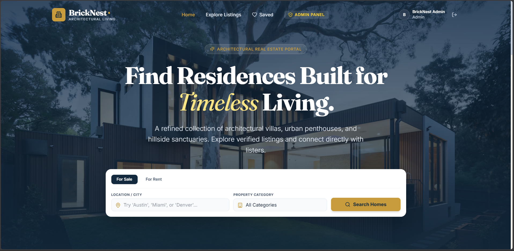
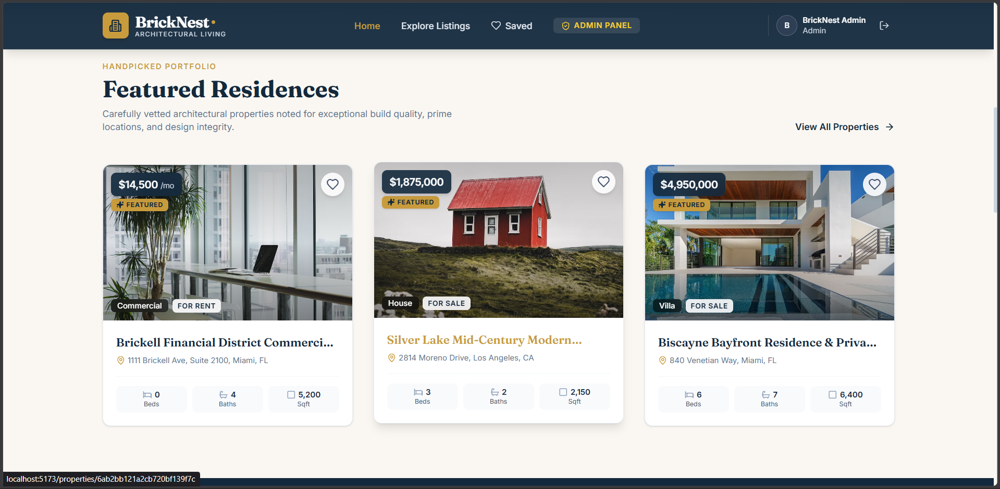
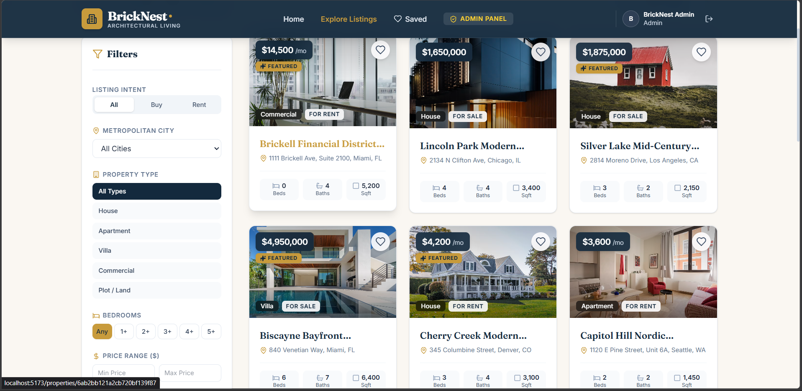
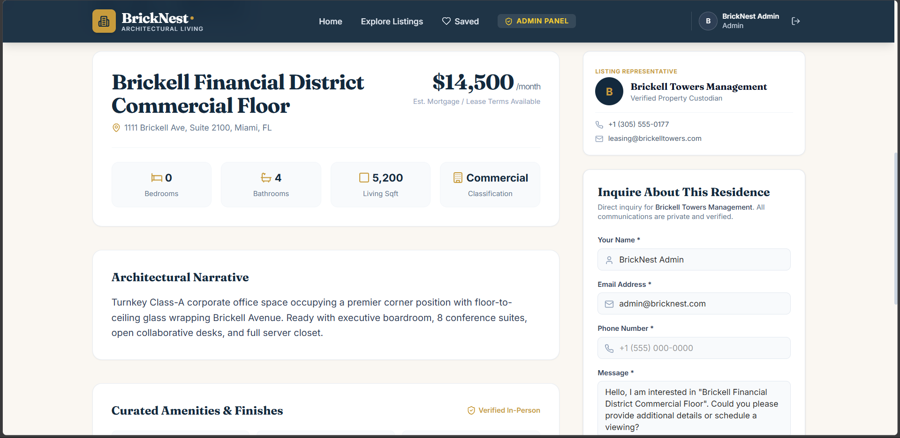
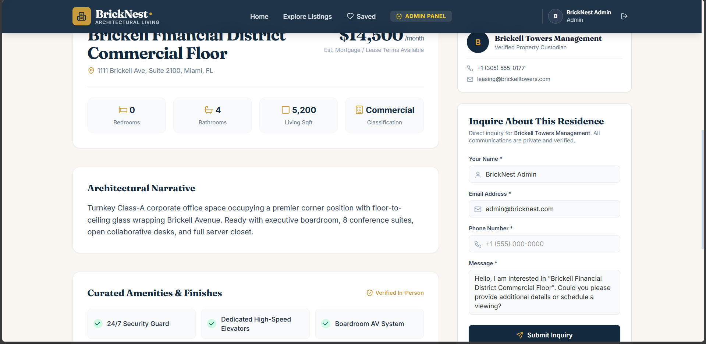
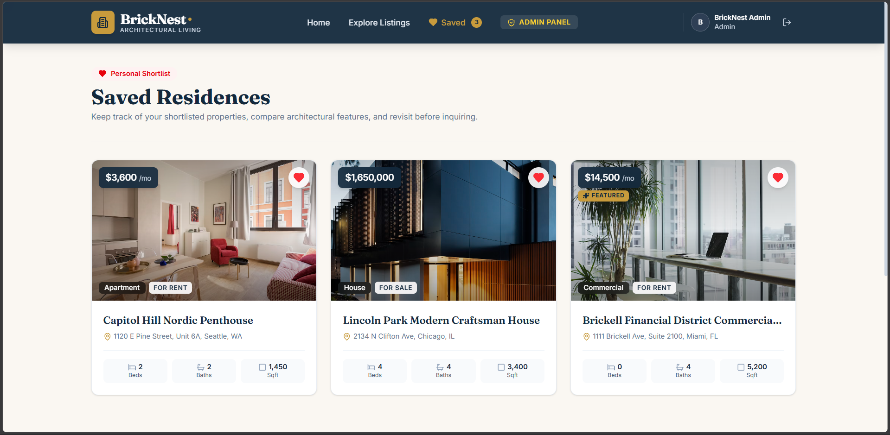
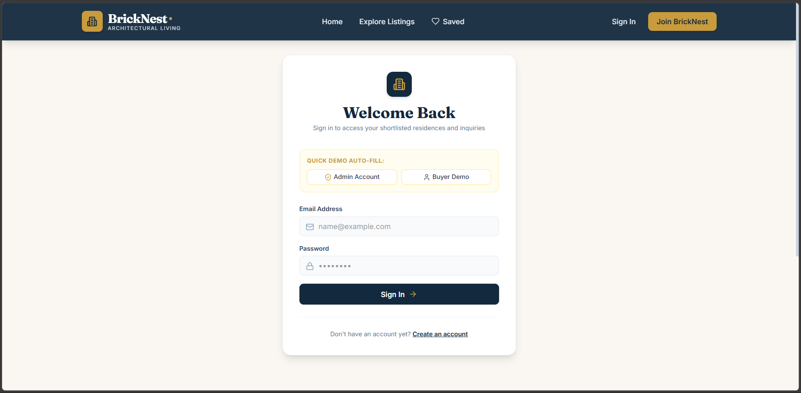
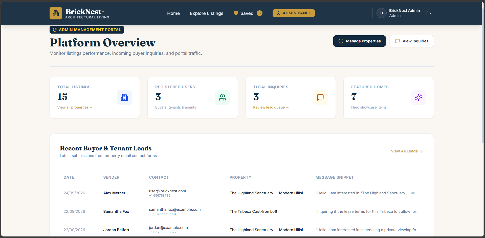
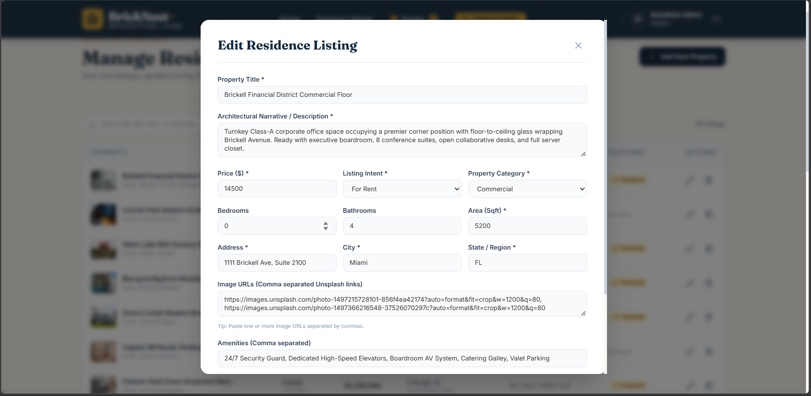
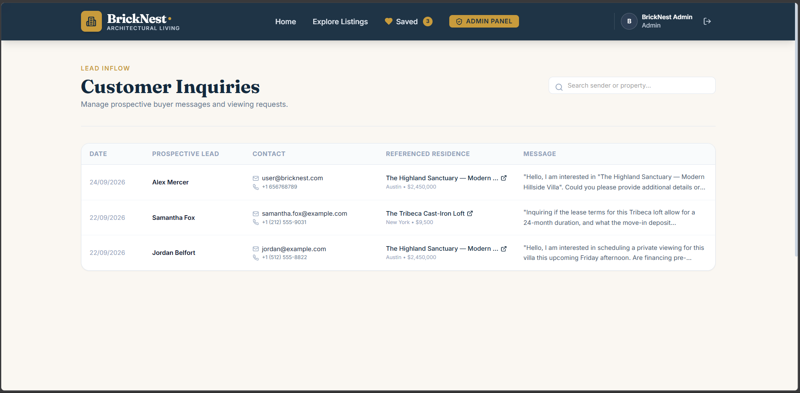

# 🏡 BrickNest — Real Estate Portal

> **BrickNest** is a modern full-stack MERN real estate portal inspired by platforms like Zillow, Realtor.com, 99acres, and MagicBricks. It connects homebuyers and renters with verified architectural residences, lofts, villas, and commercial properties with direct owner/agent inquiry channels and a dedicated administrator management dashboard.

---

## 📖 What is BrickNest?

BrickNest provides a clean, trustworthy real estate experience that moves away from cluttered aggregate sites. Built with an editorial aesthetic (deep navy, warm cream, brass gold accents, and Fraunces serif typography), it offers fluid animations, verified specifications, deep URL-synchronized filtering, user shortlisting, and zero-spam direct inquiry capture.

---

## ✨ Key Features

- **🔍 Search & Multi-Facet Filtering**: Filter properties by city, listing intent (Buy vs. Rent), property classification (House, Apartment, Villa, Commercial, Plot), minimum bedroom count, and customized price ranges — all synchronized in real-time with browser URL query parameters.
- **🏙️ Curated Listings & Dynamic Sorting**: Responsive grid view with prominent price tags, bed/bath/sqft indicators, and sort options (Price: Low to High, Price: High to Low, Newest First).
- **📸 Comprehensive Property Detail**: Interactive photo gallery with thumbnail previews, architectural story, full room and square footage specs, verified amenities pills, and custodian details.
- **❤️ Shortlisting & Saved Favorites**: Logged-in users can save properties with an animated heart toggle, preserving their personal shortlist across sessions.
- **📬 Direct "Contact Owner" Inquiries**: Visitors and registered buyers can submit direct viewing or purchase inquiries via the property detail page; inquiries are stored for admin review without third-party email dependencies.
- **🛡️ Complete Administrator Suite**:
  - **Overview Dashboard**: Live statistics on properties listed, registered users, and total incoming inquiries.
  - **Property Inventory CRUD**: Create new listings with comma-separated images, edit existing details/pricing, or delete archived homes.
  - **Inquiries Lead Table**: Review all buyer messages, phone numbers, email addresses, and timestamps linked directly to the referenced property.
- **🔐 Secure Authentication & Roles**:
  - JSON Web Token (JWT) stateless auth stored securely in `localStorage`.
  - Passwords hashed using `bcryptjs` with salt rounds.
  - Role-based route gating (`user` vs. `admin`) on both frontend and backend.
  - 1-click demo login buttons for both Admin and Buyer accounts.
- **🎬 Restrained Motion Design**:
  - Parallax hero background drifting on page scroll.
  - 60fps animated numeric counters in the trust section.
  - Card lift and image zoom on hover (`scale: 1.04`).
  - Subtle floating ambient architectural geometry in the background.
  - Smooth page transitions powered by Framer Motion.

---

## 💻 Tech Stack

| Layer                   | Technology                                    |
| ----------------------- | --------------------------------------------- |
| **Frontend Framework**  | React 18 (Vite)                               |
| **Styling & Theme**     | Tailwind CSS v4 (via `@tailwindcss/vite`)     |
| **Animations & Motion** | Framer Motion (v12)                           |
| **Icons**               | Lucide React                                  |
| **Client Routing**      | React Router v7                               |
| **HTTP Client**         | Axios (with JWT interceptors)                 |
| **Backend Runtime**     | Node.js & Express.js                          |
| **Database & ODM**      | MongoDB with Mongoose                         |
| **Authentication**      | JSON Web Tokens (`jsonwebtoken`) + `bcryptjs` |
| **Environment Config**  | `dotenv` & `cors`                             |

---

## 📦 Required Libraries & Packages

### 1. Backend (`/server`)

Install all backend dependencies:

```bash
cd server
npm install express mongoose dotenv cors jsonwebtoken bcryptjs
```

| Package        | Purpose                                                                |
| -------------- | ---------------------------------------------------------------------- |
| `express`      | Minimalist web application framework for routing and middleware.       |
| `mongoose`     | Object Data Modeling (ODM) library for MongoDB schemas and validation. |
| `dotenv`       | Loads environment variables from `.env` into `process.env`.            |
| `cors`         | Middleware to allow cross-origin requests from the React frontend.     |
| `jsonwebtoken` | Generates and verifies JWT tokens for user sessions.                   |
| `bcryptjs`     | Hashes and salts user passwords before saving to the database.         |

---

### 2. Frontend (`/client`)

Install dependencies:

```bash
cd client
npm install react react-dom react-router-dom axios framer-motion lucide-react
npm install -D vite @vitejs/plugin-react tailwindcss @tailwindcss/vite
```

| Package               | Purpose                                                                         |
| --------------------- | ------------------------------------------------------------------------------- |
| `react` & `react-dom` | Core React library and DOM renderer.                                            |
| `react-router-dom`    | Declarative routing, navigation hooks, and URL search param handling.           |
| `axios`               | Promise-based HTTP client with request/response interceptors for JWT.           |
| `framer-motion`       | Production-ready animation library for parallax, page transitions, and reveals. |
| `lucide-react`        | Modern, lightweight icon collection.                                            |
| `tailwindcss` (v4)    | Utility-first CSS framework.                                                    |
| `@tailwindcss/vite`   | Official Vite plugin for Tailwind CSS v4.                                       |
| `vite`                | Fast frontend build tool and local development server.                          |

---

## 📸 Screenshots

<!-- Add your website screenshots below -->

### 1. Homepage & Parallax Hero

> Full-width architectural hero with location search and category filters.
> 

### 2. Featured Residences & Trust Metrics

> Curated listings showcase and 60fps animated counters.
> 

### 3. Listings Grid & Filter Sidebar

> Responsive property grid with multi-filter sidebar (city, price, beds, category).
> 

### 4. Property Detail Page & Gallery

> High-resolution image showcase with thumbnail switcher and architectural specs.
> 

### 5. Direct Contact Owner / Lead Form

> Inquiry submission widget delivering messages directly to the lister.
> 

### 6. User Saved Shortlist (Favorites)

> Personal collection of bookmarked properties for authenticated buyers.
> 

### 7. Sign In & 1-Click Demo Login

> Clean authentication card with one-click auto-fill for Admin and Buyer roles.
> 

### 8. Admin Dashboard

> Overview metrics tracking active listings, registered users, and incoming leads.
> 

### 9. Admin Inventory Management (CRUD)

> Data table with modal to create, update, or remove property listings.
> 

### 10. Admin Inquiries Lead Queue

> Detailed log of incoming buyer inquiries linked to respective properties.
> 

---

## 🚀 Quick Setup & Run

### 1. Configure `.env`

In `server/.env`:

```env
PORT=5000
MONGO_URI=your_mongodb_connection_string
JWT_SECRET=your_jwt_secret_key
CLIENT_URL=http://localhost:5173
```

### 2. Seed Database

Populates ~15 realistic properties + 1 admin account (`admin@bricknest.com` / `admin123`) + 1 buyer account (`user@bricknest.com` / `user123`):

```bash
npm run seed --prefix server
```

### 3. Start Development Servers

```bash
# Terminal 1: Backend API (http://localhost:5000)
cd server
npm run dev

# Terminal 2: Frontend Client (http://localhost:5173)
cd client
npm run dev
```

---

## 🔑 Default Test Accounts

| Role      | Email                 | Password   | Access                        |
| --------- | --------------------- | ---------- | ----------------------------- |
| **Admin** | `admin@bricknest.com` | `admin123` | Full CRUD, metrics, inquiries |
| **Buyer** | `user@bricknest.com`  | `user123`  | Browse, shortlist, inquire    |

---

## 📄 License

This project is open-source and free to use for educational and commercial purposes.
